# ShopPulse — Data Pipeline & Analytics Lakehouse sur Databricks

Pipeline batch et micro-batch qui transforme des transactions brutes (JSON) en indicateurs métier, selon une architecture Médaillon **Bronze → Silver → Gold**, sur Databricks (Free Edition), avec Delta Lake, PySpark et Databricks SQL. Le pipeline est orchestré par un job et déployé dans deux environnements : `dev` et `prod`.

---

## 1. Architecture

```
Fichiers JSON          BRONZE                    SILVER                         GOLD                         RESTITUTION
(volume raw/landing)   shoppulse_bronze          shoppulse_silver               shoppulse_gold_user_metrics  v_user_metrics
                       données brutes            dédupliquée, typée,            CA et panier moyen           vue métier
        ──Auto Loader──▶ + ingestion_timestamp ──▶ COMPLETED uniquement ──────────▶ par client et par mois ──────▶ + dashboard
                         + source_file             alimentée par MERGE            recalculée (overwrite)
```

**Organisation Unity Catalog**

```
shoppulse                                  catalog : le projet
 ├── dev                                   schema : environnement de développement
 │    ├── raw            (volume)          fichiers JSON : generated/ (lots générés), landing/ (zone d'arrivée)
 │    ├── checkpoints    (volume)          mémoire d'Auto Loader
 │    ├── shoppulse_bronze
 │    ├── shoppulse_silver
 │    ├── shoppulse_gold_user_metrics
 │    └── v_user_metrics (vue)
 └── prod                                  schema : production, même structure
```

Le même code tourne dans les deux environnements : seul le paramètre `schema` change.

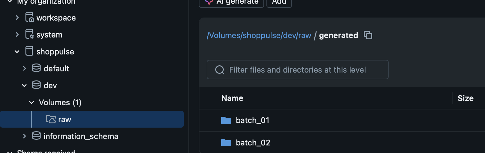

*Le volume `raw` du schema `dev`, avec les deux lots générés dans `generated/`.*

**Organisation du workspace**

```
shoppulse/
 ├── pipeline/                  exécutés par le job, dans l'ordre
 │    ├── 00_setup              schema, volumes, dossier landing, table Silver
 │    ├── 01_bronze_ingestion   Auto Loader → Bronze
 │    ├── 02_silver             cast, déduplication, MERGE → Silver
 │    └── 03_gold               agrégations → Gold, création de la vue
 ├── analyse/
 │    ├── 05_time_travel        comparaison de versions de la Silver
 │    └── 06_restitution        vue, requêtes métier, graphiques
 ├── outils/
 │    └── 00_generate_data      génération et dépôt des lots de test
 └── exploration/               notebooks de travail (archive)
```

**Technologies** : Databricks Free Edition (compute serverless, Unity Catalog), PySpark, Delta Lake, Auto Loader, Databricks SQL, dashboards AI/BI, Lakeflow Jobs.

---

## 2. Données de test

Les données sont générées par un script Python (`outils/00_generate_data`, bibliothèque standard uniquement, graine fixe donc reproductible). Format : JSON Lines, une transaction par ligne.

```json
{"transaction_id": "TX00000987", "user_id": "U0196", "product_id": "P110", "amount": 92.53, "transaction_date": "2026-01-26T16:12:17", "status": "COMPLETED"}
```

| Lot | Lignes | Contenu | Ce qu'il permet de tester |
|---|---|---|---|
| Lot 1 | 5 150 | 5 000 transactions d'octobre 2025 à août 2026 (≈ 70 % COMPLETED, 20 % PENDING, 10 % CANCELLED) | Chargement initial |
| Lot 2 | 1 236 | 1 000 nouvelles transactions (septembre 2026) | INSERT du MERGE |
| | | 150 transactions du lot 1 passées de PENDING à COMPLETED | Mise à jour d'état |
| | | 50 lignes du lot 1 renvoyées à l'identique | Idempotence du MERGE |

**Pièges volontaires** dans les deux lots :
- ≈ 3 % de **doublons stricts** (lot 1 : 150 doublons, 5 150 lignes pour 5 000 transactions) ;
- ≈ 1 % de **dates au format `dd/MM/yyyy HH:mm:ss`** au lieu du format ISO.

Pour simuler une arrivée progressive, les lots sont copiés l'un après l'autre dans le dossier `landing`, seul dossier lu par le pipeline.

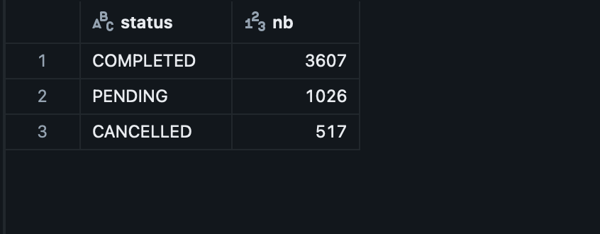

*Lecture directe des fichiers du lot 1 avec `read_files` : 3 607 + 1 026 + 517 = 5 150 lignes, dont 150 doublons.*

---

## 3. Le pipeline, couche par couche

### Bronze — `01_bronze_ingestion`

- Ingestion incrémentale avec **Auto Loader** (`cloudFiles`) en `trigger(availableNow=True)` : le flux traite les nouveaux fichiers puis s'arrête (**micro-batch**).
- Le **checkpoint** mémorise les fichiers déjà lus : relancer le notebook ne réingère rien (**idempotence**, vérifiée : 5 150 lignes après deux exécutions).
- Colonnes techniques : `ingestion_timestamp` (exigence de l'énoncé) et `source_file` (fichier d'origine).
- `cloudFiles.inferColumnTypes` pour obtenir de vrais types (`amount` en `double`) ; la colonne `_rescued_data` conserve toute valeur non conforme au schéma au lieu de la perdre (0 ligne concernée).
- Aucune règle métier : la Bronze reflète exactement ce qui est arrivé.

### Silver — `02_silver`

| Règle | Implémentation | Pourquoi |
|---|---|---|
| Cast de `transaction_date` en `TimestampType` | `coalesce(try_to_timestamp(ISO), try_to_timestamp('dd/MM/yyyy HH:mm:ss'))` | Gère les deux formats ; `try_to_timestamp` renvoie `NULL` au lieu de planter, contrôle : 0 date nulle |
| Déduplication sur `transaction_id` | Fenêtre `row_number()` partitionnée par `transaction_id`, triée sur `ingestion_timestamp` décroissant | Garde l'état **le plus récent** de chaque transaction ; `rank()` aurait gardé les doublons ex-aequo |
| Filtre `status = 'COMPLETED'` | Appliqué **dans le MERGE**, après la déduplication | Une transaction COMPLETED puis CANCELLED doit sortir de la Silver ; filtrer avant aurait masqué l'annulation |
| Écriture incrémentale | `MERGE INTO` sur `transaction_id` | Met à jour sans tout réécrire |

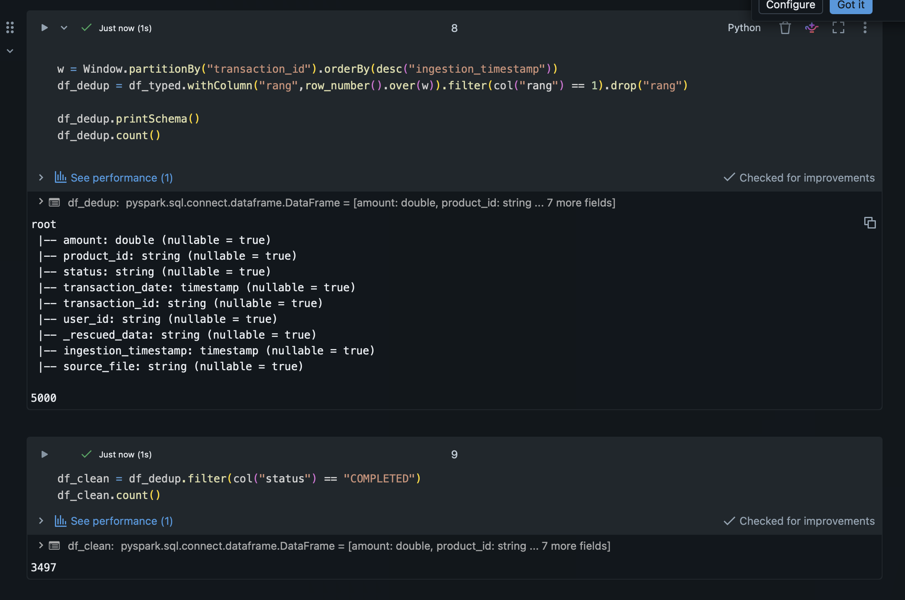

*Déduplication avec `row_number()` : 5 150 → 5 000 lignes, puis 3 497 transactions COMPLETED.*

```sql
MERGE INTO shoppulse.<env>.shoppulse_silver AS t
USING silver_updates AS s
ON t.transaction_id = s.transaction_id
WHEN MATCHED AND s.status <> 'COMPLETED'                       THEN DELETE
WHEN MATCHED AND s.ingestion_timestamp > t.ingestion_timestamp THEN UPDATE SET *
WHEN NOT MATCHED AND s.status = 'COMPLETED'                    THEN INSERT *
```

La source du MERGE contient l'état le plus récent de **toutes** les transactions (5 000 après le lot 1), sélectionnées sur les 7 colonnes de la Silver (contrat explicite). La table Silver est créée à l'avance par `00_setup` avec un schéma explicite, car un MERGE exige une cible existante.

**Résultats du MERGE**

| Exécution | Insertions | Mises à jour | Suppressions | Lignes en Silver |
|---|---|---|---|---|
| Lot 1 | 3 497 | 0 | 0 | 3 497 |
| Relance sans nouvelles données | 0 | 0 | 0 | 3 497 |
| Lot 2 | 856 | 38 | 0 | 4 353 |

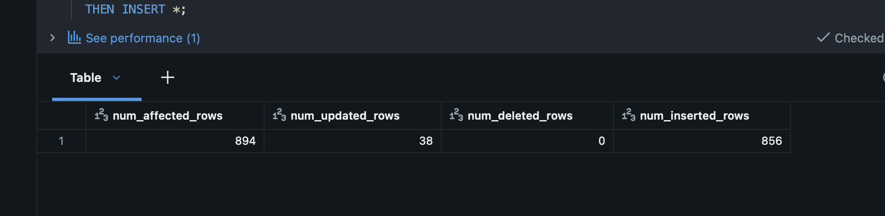

*Résultat du MERGE à l'arrivée du lot 2.*

Lot 2 : 856 insertions = ≈ 700 nouvelles transactions COMPLETED + 150 transactions passées de PENDING à COMPLETED (absentes de la Silver, donc insérées et non mises à jour). Les 38 mises à jour correspondent aux lignes COMPLETED renvoyées à l'identique, avec un `ingestion_timestamp` plus récent.

### Gold — `03_gold`

- Agrégation par `user_id` et par mois (`trunc(transaction_date, 'month')`, type `DATE`) : CA total (`total_amount`), panier moyen (`avg_basket`), nombre de commandes (`nb_orders`), montants arrondis à 2 décimales.
- Écriture en **`overwrite`** : la table est petite (2 260 lignes) et une moyenne ne s'additionne pas, un recalcul complet garantit une Gold toujours cohérente avec la Silver.
- La vue `v_user_metrics` est créée en fin de notebook (`CREATE OR REPLACE VIEW`), pour exister dans chaque environnement.

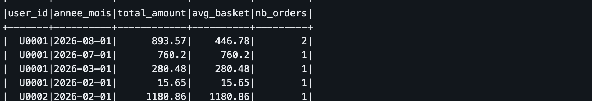

*Une ligne par client et par mois ; `annee_mois` est une vraie date (1er jour du mois).*

---

## 4. Time Travel — impact du lot 2

`DESCRIBE HISTORY` liste les versions de la Silver ; `VERSION AS OF` relit une version antérieure (`analyse/05_time_travel`).

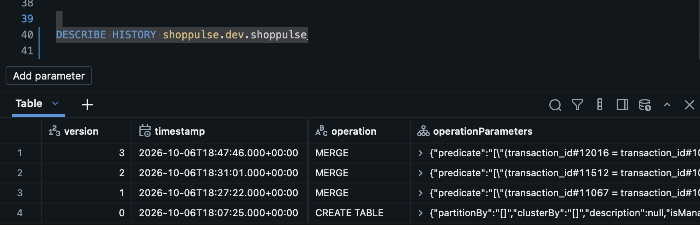

*Historique de la Silver en `dev` : création de la table, puis un MERGE par exécution.*

| État de la Silver | Transactions | CA total (€) |
|---|---|---|
| Avant le lot 2 | 3 497 | 907 078,43 |
| Après le lot 2 | 4 353 | 1 127 611,48 |
| **Impact du lot 2** | **+856** | **+220 533,05** |

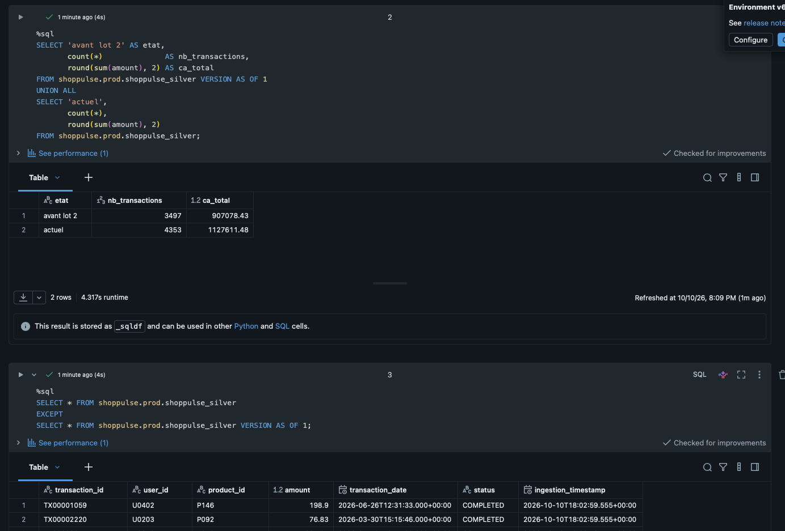

*Comparaison en `prod` : version 1 (avant le lot 2) contre version actuelle, puis `EXCEPT` des lignes ajoutées ou modifiées.*

Les chiffres sont identiques en `dev` et en `prod`, mais pas les numéros de version : la version « avant le lot 2 » est la version 3 en `dev` (plusieurs MERGE de test) et la version 1 en `prod`. Chaque exécution, même sans changement, crée une version : le numéro se lit donc dans `DESCRIBE HISTORY` avant chaque comparaison.

Un `EXCEPT` entre la version actuelle et la version antérieure renvoie 894 lignes, soit 856 insertions + 38 mises à jour. Les 38 mises à jour ne modifient que `ingestion_timestamp` : elles n'ont aucun effet sur le CA.

---

## 5. Restitution

Vue métier `v_user_metrics` (colonnes renommées : `chiffre_affaires`, `panier_moyen`, `nb_commandes`) et deux requêtes (`analyse/06_restitution`) :

```sql
-- Top 10 des clients générant le plus de valeur
SELECT user_id, round(sum(chiffre_affaires), 2) AS ca_total, sum(nb_commandes) AS nb_commandes
FROM shoppulse.<env>.v_user_metrics
GROUP BY user_id
ORDER BY ca_total DESC
LIMIT 10;

-- Distribution des ventes par mois
SELECT annee_mois, round(sum(chiffre_affaires), 2) AS ca_total, sum(nb_commandes) AS nb_commandes
FROM shoppulse.<env>.v_user_metrics
GROUP BY annee_mois
ORDER BY annee_mois;
```

**Dashboards AI/BI** : « ShopPulse – Dev » et « ShopPulse – Production », avec le Top 10 clients, l'histogramme du CA mensuel et l'évolution du nombre de commandes.

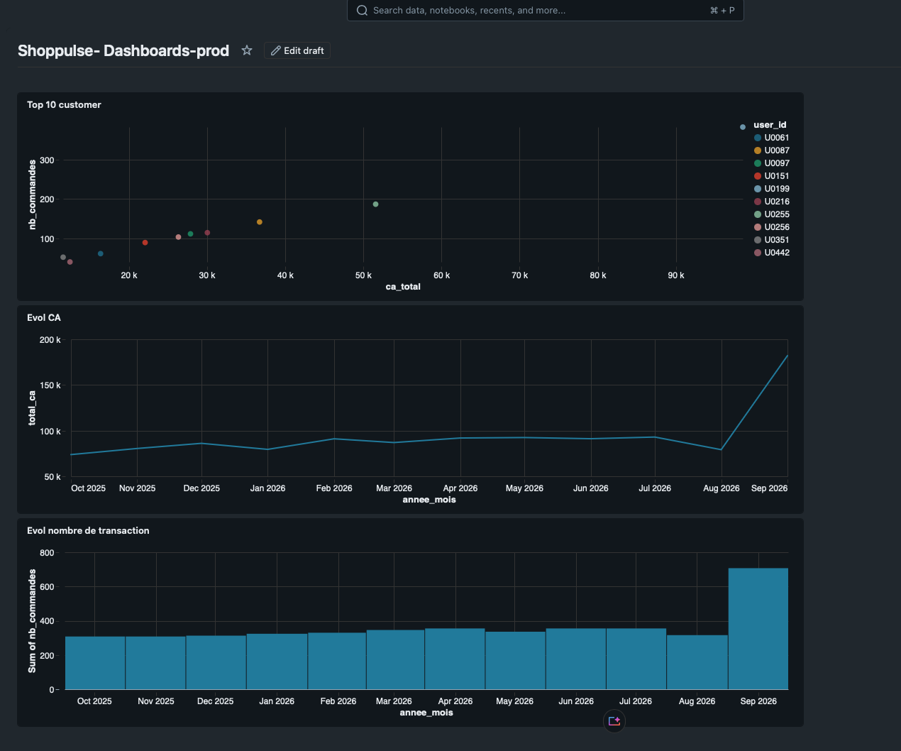

*Dashboard de production : Top 10 clients, CA mensuel et nombre de commandes par mois.*

**Enseignements**
- Les 10 meilleurs clients ont un panier moyen proche : leur valeur vient de la **fréquence d'achat** (U0199 en tête, ≈ 98 k€ pour ≈ 380 commandes), pas de paniers plus élevés.
- **Pic de septembre 2026** (≈ 180 k€ contre 80-90 k€ les autres mois) : artefact des données de test. Le lot 1 répartit 5 000 transactions sur 11 mois, le lot 2 place ses 1 000 nouvelles transactions toutes en septembre. Ce n'est pas un phénomène métier.

---

## 6. Déploiement

**Paramétrage.** Chaque notebook du pipeline lit deux widgets : `catalog` (texte, `shoppulse`) et `schema` (liste `dev` / `prod`). Tous les noms de tables et chemins de volumes sont construits à partir de ces paramètres : aucun environnement n'est écrit en dur.

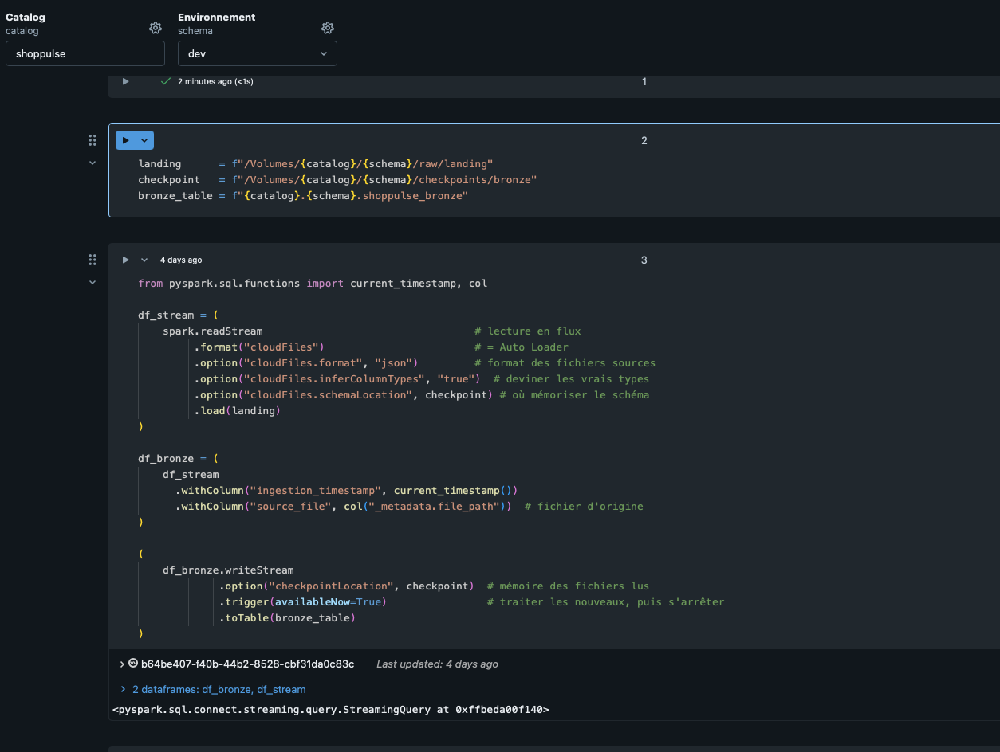

*Les widgets « Catalog » et « Environnement » en haut du notebook Bronze ; les chemins et noms de tables en sont dérivés.*

**Jobs.** Deux jobs Lakeflow, identiques à un paramètre près :

| Job | Paramètres | Tâches |
|---|---|---|
| `shoppulse_pipeline_dev` | `catalog = shoppulse`, `schema = dev` | `setup → bronze → silver → gold` |
| `shoppulse_pipeline_prod` | `catalog = shoppulse`, `schema = prod` | `setup → bronze → silver → gold` |

- Compute serverless ; chaque tâche ne démarre que si la précédente a réussi.
- *Max concurrent runs* = 1 : deux exécutions simultanées ne partagent jamais le même checkpoint ni le même MERGE.
- Tous les notebooks sont **idempotents** (`IF NOT EXISTS`, checkpoint, MERGE conditionnel, `overwrite`, `CREATE OR REPLACE`) : un job peut être relancé sans fausser les données.

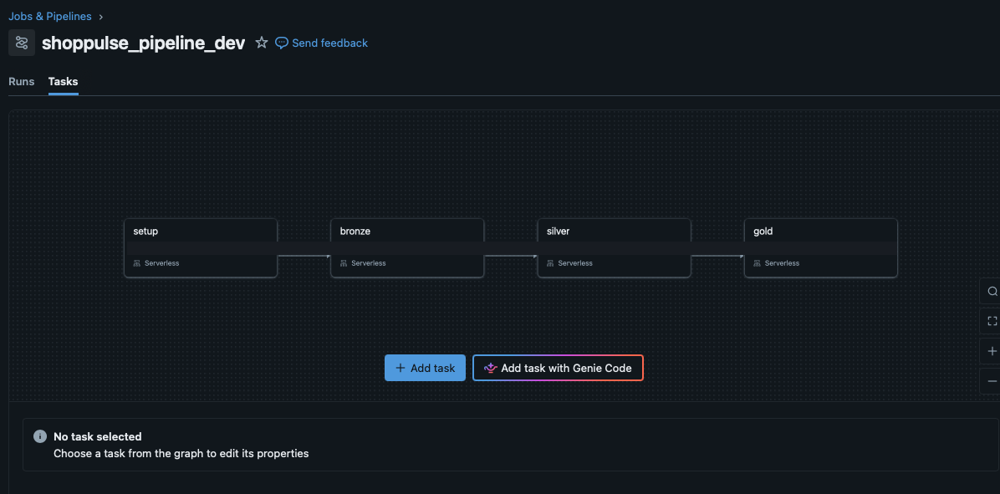

*Le job `shoppulse_pipeline_dev` : quatre tâches chaînées, compute serverless.*

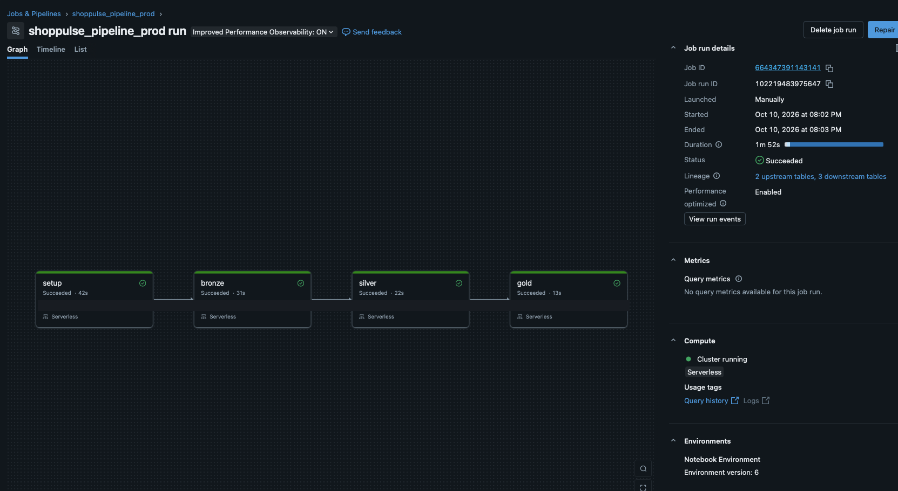

*Exécution réussie du job `shoppulse_pipeline_prod` en 1 min 52 s.*

**Mise en production.** Le job prod a été obtenu par clonage du job dev. Premier déploiement : exécution de `00_setup` sur `prod`, dépôt du lot 1 dans `/Volumes/shoppulse/prod/raw/landing` (Auto Loader ne peut pas inférer de schéma sur un dossier vide), exécution du job, puis dépôt du lot 2 et nouvelle exécution. La prod produit les mêmes volumes que la dev :

| Table | Après le lot 1 | Après le lot 2 |
|---|---|---|
| Bronze | 5 150 | 6 386 |
| Silver | 3 497 | 4 353 |
| Gold | 1 934 | 2 260 |

---

## 7. Comment rejouer le projet

1. Créer le catalog `shoppulse` et importer les notebooks dans le workspace.
2. Exécuter `pipeline/00_setup` (widget `schema = dev`).
3. Exécuter `outils/00_generate_data` : génère les deux lots dans `raw/generated` et copie le lot 1 dans `raw/landing`.
4. Lancer le job `shoppulse_pipeline_dev`.
5. Copier le lot 2 dans `raw/landing` et relancer le job.
6. Consulter `analyse/05_time_travel`, `analyse/06_restitution` et le dashboard.

---

## 8. Limites et améliorations possibles

| Sujet | Amélioration |
|---|---|
| Déploiement | Décrire les jobs et le dashboard dans un **Databricks Asset Bundle** (`databricks.yml`, cibles `dev` / `prod`) et déployer par `databricks bundle deploy -t prod`, versionné dans Git : supprime le clonage manuel et le risque d'oublier un paramètre. |
| Qualité des données | Ajouter une tâche de contrôles automatiques (`assert` : pas de doublon, uniquement des COMPLETED, pas de date nulle, réconciliation Gold / Silver) qui fait échouer le job si une règle est violée. |
| Montants | Utiliser `DECIMAL(10,2)` au lieu de `DOUBLE` pour les montants (le type `DOUBLE` produit des décimales parasites dans les sommes). |
| MERGE | N'appliquer l'`UPDATE` que si une valeur métier a changé, pour éviter de réécrire les lignes renvoyées à l'identique (38 mises à jour inutiles au lot 2). |
| Silver | Ne lire que les nouvelles lignes de la Bronze (Change Data Feed) au lieu de relire toute la table à chaque exécution. |
| Données de test | Répartir les nouvelles transactions du lot 2 sur plusieurs mois pour éviter le pic artificiel de septembre. |
| Planification | Ajouter un déclencheur planifié ou à l'arrivée de fichiers sur le job prod. |
